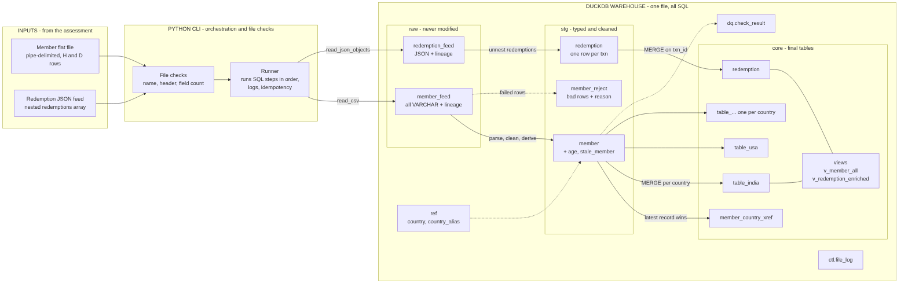
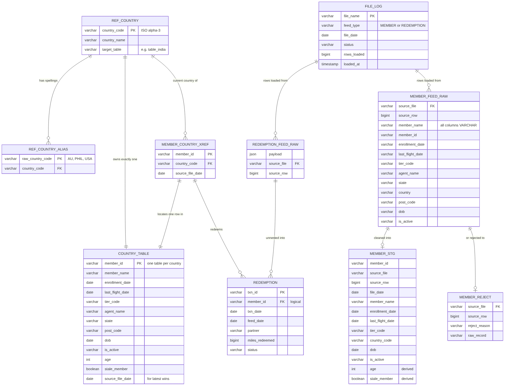

# SkyPoints Loyalty Pipeline: Architecture & Design

> Incubyte Data Craftsperson assessment.
> **Legend used throughout:** 📄 = stated in the assessment PDF · 🧠 = my decision or assumption (open to change).

---

## 1. Problem summary 📄

SkyPoints is a global airline loyalty program with millions of members. The source system produces **two daily feeds**:

| Feed | Format |
|---|---|
| **Member profile** | Pipe-delimited flat file. Row type `H` = header, `D` = detail |
| **Redemption transactions** | Semi-structured JSON: one object per member with a nested `redemptions` array |

Required outcomes (the assessment's six deliverables):

| # | Deliverable |
|---|---|
| D1 | DDL for the raw/landing table, staging table, and country-specific target tables |
| D2 | Load staging with derived columns **Age** (from DOB) and **Stale_Member** (days since flight date > 90) |
| D3 | Split members into per-country tables; **latest record wins** when a member moved countries |
| D4 | Flatten the JSON redemption feed into a queryable table; describe how it joins back to members |
| D5 | Data validations: mandatory fields, key uniqueness, and checks for the data issues visible in the samples |
| D6 | Live demo at interview |

Non-functional requirement 📄: *"Create the process considering we are getting billions of records every day, across both the flat file and the JSON feed."*

**In scope 🧠:** the two feeds above, loaded into country tables.
**Optional extension 🧠:** the `IND/USA/AUS` sample spreadsheets attached to the email (§12). The PDF never mentions them.

---

## 2. What the PDF says vs. what I decided

### 2.1 Spec inconsistencies found in the PDF

| # | The PDF says 📄 | Problem | Decision 🧠 |
|---|---|---|---|
| 1 | Column table marks **Member Name** as the Key Column; Member ID is not | A name cannot identify a member (two "Elena"s). "Latest wins across countries" needs a stable identity | Key = **`member_id`**, configurable in one place. Confirm with Incubyte |
| 2 | Column table lists **11 fields** (incl. Post Code). Header and sample rows show **10** | A strict parser breaks on one of them | Parser accepts 10 or 11 fields; `post_code` nullable |
| 3 | Post Code is `INT` | Loses leading zeros (US `02134`); can't hold Canadian `K1A 0B1` | Stored as `VARCHAR` |
| 4 | Sample countries: `USA`, `IND`, `PHIL`, `CAN`, `AU` | Mixed standards: ISO-3, non-ISO (`PHIL`), ISO-2 (`AU`). Same country could split into two tables | `ref.country` + `ref.country_alias` map spellings to ISO alpha-3. Unmapped → rejected and reported |
| 5 | Dates are `YYYYMMDD`, but DOB is `03051985` | Different format; ambiguous (3 May or 5 March?) | One configurable DOB format, default `DDMMYYYY`; a DQ check detects which format the data really follows |
| 6 | Staging sample shows DOB as `3051985` | Leading zero lost: a number-typing bug | Raw is **all VARCHAR**; parse afterwards |
| 7 | Staging sample shows **Agent_Name blank** for 4 of 5 rows; raw file has `Sam` everywhere | Data lost between raw and staging | Row-count reconciliation + null-rate comparison |
| 8 | Staging column named `County` | Typo | `country_code` in our DDL |
| 9 | "Developers should know all the places the member data is available" | Country list should come from data, not be assumed | Pipeline reports distinct countries found; any not in `ref.country` is flagged |
| 10 | "Billions of records every day" vs "millions of members" | After one-row-per-member dedupe, member volume is millions. **Redemptions** are the true billions | Heavy-volume design centres on redemptions (§6) |

### 2.2 Assumptions to confirm with Incubyte 🧠

| # | Question | Default used |
|---|---|---|
| Q1 | Is the Key Column on *Member Name* a typo for *Member ID*? | `member_id` |
| Q2 | DOB format: `DDMMYYYY` or `MMDDYYYY`? | `DDMMYYYY` |
| Q3 | Is Post Code in the real file? | Optional |
| Q4 | Which country code standard? | ISO alpha-3 + alias table |
| Q5 | What defines "latest" when a member appears twice? | Feed file date, then row order |
| Q6 | When a member moves, delete the old row or keep history? | Delete (full history stays in `raw`) |
| Q7 | `Stale_Member` when there is no flight date? | `NULL` (unknown) |
| Q8 | Unknown country: create a table or reject? | Reject, report |

---

## 3. Architecture 🧠



### 3.1 Layers

| Schema | Objects | Purpose |
|---|---|---|
| `raw` | `member_feed`, `redemption_feed` | Exact copy of what arrived. **All member columns are VARCHAR.** Adds lineage: `source_file`, `source_row`, `loaded_at`. Never updated |
| `stg` | `member`, `member_reject`, `redemption`, `redemption_reject` | Typed, trimmed, normalised. Derived `age` and `stale_member`. Rows that fail validation go to a `*_reject` table **with the reason** |
| `core` | `table_<country>` × N, `member_country_xref`, `redemption`, views | Final tables. Country tables hold one live row per member. The xref records each member's current country |
| `ref` | `country`, `country_alias` | Lookup data that drives the pipeline: adding a country is a data change, not a code change |
| `dq` | `check_result` | One row per check per run: rows checked, rows failed, severity, status |
| `ctl` | `file_log` | One row per file loaded. Makes re-runs **idempotent** |

This matches the three table types D1 names (raw/landing, staging, country target).

### 3.2 Components

| Component | Responsibility |
|---|---|
| **Python CLI** (`skypoints`) | Pre-load file checks, runs SQL files in order, logging, exit codes, idempotency check. **Never touches data rows** |
| **SQL files** (`sql/`) | All transformation logic. Readable by reviewers; portable to other engines |
| **DuckDB** | The warehouse: a single file, no server, no account |

---

## 4. Key design decisions 🧠

| # | Decision | Alternatives | Rationale |
|---|---|---|---|
| D1 | **ELT**: load raw, then transform with SQL inside the warehouse | ETL: transform in Python first | Raw copy is preserved for replay and audit. A bad value can't crash the load. SQL engines scale where a Python script holding rows in memory does not |
| D2 | **DuckDB** as the engine | Snowflake (30-day trial), Postgres, Spark | Free forever, no account or credit card, runs anywhere. Reviewers can clone and run in a minute. CI can run the **whole pipeline** as a test. Dialect is close to Snowflake/Postgres, so logic ports. *Verified:* reads pipe-delimited and JSON files, `QUALIFY`, `MERGE`, transactions, enforced primary keys, `TRY_STRPTIME` |
| D3 | **Raw = all VARCHAR** | Typed load | A typed load can fail on one bad value. VARCHAR always loads; bad rows are isolated at the parse step |
| D4 | **Quarantine, don't drop** | Drop; or fail the whole batch | Dropping hides loss; failing everything blocks millions of good rows over one bad one. A **reject-rate threshold** still stops the batch when the *file* is broken |
| D5 | **Country tables generated from `ref.country`** | Hard-code 5 tables | The PDF says "and so on for each country" |
| D6 | **`member_country_xref`**: member → current country | Probe every country table | Detecting a move needs "where was this member before?". One keyed lookup beats probing N tables. Also the join target for redemptions |
| D7 | **"Latest" = feed file date, then row number** | `last_flight_date`; load time | The spec has no `updated_at`. File date is the closest proxy for when the source stated it. A **late-arriving older file must not overwrite newer data**: `WHEN MATCHED AND src.file_date >= tgt.file_date` |
| D8 | **A move = delete from old table + upsert into new, in one transaction** | SCD2 history in country tables | "Latest wins" = one live row per member. The transaction guarantees a member is never in 0 or 2 tables. History is recoverable from `raw` |
| D9 | **`as_of_date` is a parameter, not `current_date`** | `current_date` | Re-running a past file must reproduce the same `age` and `stale_member`. Otherwise outputs drift on every rerun |
| D10 | **SQL files + thin Python runner** | dbt, Airflow | Fewer moving parts; reviewers read the SQL directly. dbt/Airflow are named in the production path (§6) |
| D11 | **Post code, tier, state, country as VARCHAR** | INT / fixed CHAR | INT drops leading zeros and rejects alphanumerics |
| D12 | **Tests run the full pipeline on fixtures in an in-memory DuckDB** | Mock the database | Real SQL under test, including the move scenario. Runs in CI in seconds |
| D13 | **Constraints plus DQ checks** (defence in depth) | Constraints only | DuckDB enforces `PRIMARY KEY`, but cross-table rules (a member in exactly one country table) can't be expressed as a constraint. They are verified by DQ checks. On Snowflake PK/FK aren't enforced at all, so the same checks make the logic portable |

---

## 5. Why ELT over ETL (short version)

| | ETL (transform before load) | ELT (this project) |
|---|---|---|
| Original data | Gone after transform | Preserved in `raw` |
| One bad value | Can fail the load | Loads; bad row isolated later |
| Bug found next month | Re-request the source files | Replay from `raw` |
| Scale | Bound by the transform process's memory | Bound by the SQL engine, which streams and parallelises |
| Auditability | Logic hidden in code | Logic in readable SQL |

---

## 6. Scaling to billions of records per day 📄🧠

The logic is identical at 5 rows or 5 billion. What changes is shape and placement.

| Concern | Technique |
|---|---|
| Parallel load | Source delivers **chunked, compressed files** (~100–250 MB each). Engines parallelise per file; one giant file is single-threaded |
| Python can't hold the data | All row-level work is SQL. Python orchestrates only |
| Daily duplicates | **Dedupe first** with `QUALIFY ROW_NUMBER() … = 1`, so billions of rows collapse to at most one row per member *before* any MERGE |
| Redemptions are the volume | Insert-mostly; MERGE on `txn_id` limited to a **recent date window** (status changes like `PENDING → COMPLETED` happen shortly after the txn). Store as **Parquet partitioned by `txn_date`** so old data is never scanned |
| Reprocessing everything daily | **Incremental**: only files not yet marked processed in `ctl.file_log` |
| Idempotency and late files | File log + `file_date >=` guard (D7) |
| JSON file is one giant array | Ask the source for **NDJSON** (one object per line), which can be read in parallel |
| Beyond one machine | Same SQL ports to **Snowflake / Redshift / Spark**; ingestion moves to S3 + Snowpipe/Glue; **Airflow** schedules. A Snowflake-dialect DDL file is included to show the mapping |

**Honest limit 🧠:** DuckDB runs on one machine. The demo will process millions of rows and I'll report **measured** timings, not extrapolated ones. Billions per day needs a distributed engine or a very large single node; the design above is how this project gets there.

---

## 7. ER diagram 🧠

*(Not requested by the assessment. Included to document keys and relationships.)*



- `COUNTRY_TABLE` stands for N physical tables (`table_india`, `table_usa` …) with identical columns.
- Foreign keys are **logical**; D13 explains how they're verified.

| Relationship | Meaning |
|---|---|
| `ref.country` 1—N `country_alias` | One country, many raw spellings (`AU`/`AUS` → `AUS`, `PHIL` → `PHL`) |
| `ref.country` 1—1 country table | Each country has exactly one target table |
| `member_country_xref` 1—1 country-table row | A member lives in **exactly one** country table: the "latest wins" invariant |
| `member_country_xref` 1—N `redemption` | **The join** from the JSON feed back to member profiles (§8.3) |
| `member_feed_raw` 1—(0..1) `member` or `member_reject` | Every raw row ends in exactly one of staging or reject, so `raw = stg + reject` is a reconciliation check |

---

## 8. Core logic 🧠

*DuckDB SQL. These snippets were run against DuckDB 2.0 on sample data and behave as described; production versions are built step by step.*

### 8.1 Load the pipe-delimited file (D2 input)

```sql
SELECT *, row_number() OVER (PARTITION BY filename) AS source_row
FROM read_csv('member_20241105.txt', delim='|', header=false,
              all_varchar=true, filename=true, null_padding=true);
```
The leading `|` produces an empty first column; column 2 is the record type (`H`/`D`). Row order within a file was verified to be preserved.

### 8.2 Age and Stale_Member (D2)

```sql
date_part('year', age(:as_of_date, dob))               AS age,
date_diff('day', last_flight_date, :as_of_date) > 90   AS stale_member
```
> **Pitfall:** `date_diff('year', DATE '1998-12-31', DATE '1999-01-01')` returns **1**: it counts year *boundaries*, not full years. `age()` counts completed years, so it is correct. A `NULL` flight date gives `stale_member = NULL`.

### 8.3 Latest record wins (D3)

```sql
-- 1. one row per member from the batch
SELECT * FROM stg.member
QUALIFY row_number() OVER (PARTITION BY member_id
                           ORDER BY file_date DESC, source_row DESC) = 1;

-- 2. classify against member_country_xref
--      NEW   -> insert into the country table
--      SAME  -> update if incoming file_date >= stored file_date
--      MOVED -> delete from OLD country table, upsert into NEW

-- 3. inside ONE transaction, per active country in ref.country:
--      DELETE moved members from their old table
--      MERGE incoming rows for this country
--    then update member_country_xref
```

### 8.4 Flatten the JSON feed and join back (D4)

```sql
SELECT payload->>'$.member_id'                                   AS member_id,
       try_strptime(payload->>'$.feed_date','%Y%m%d')::date      AS feed_date,
       r->>'$.txn_id'                                            AS txn_id,
       try_strptime(r->>'$.txn_date','%Y%m%d')::date             AS txn_date,
       r->>'$.partner'                                           AS partner,
       (r->>'$.miles_redeemed')::bigint                          AS miles_redeemed,
       r->>'$.status'                                            AS status
FROM raw.redemption_feed,
     unnest(from_json(payload->'$.redemptions', '["JSON"]')) AS t(r);
```
One member object with 2 redemptions becomes **2 rows**.

**Join back to members**
1. `redemption.member_id = member_country_xref.member_id` yields the member's **current country**.
2. `core.v_member_all` is a `UNION ALL` of every country table, so analysts never need to know which table holds a member.
3. `core.v_redemption_enriched` = redemption + profile + country.

Design notes:
- `txn_id` is the key. The same txn can arrive as `PENDING` then `COMPLETED`; MERGE on `txn_id`, newest feed wins.
- **Orphans** (redemption for a member not yet loaded) are kept and flagged, not dropped.
- **Point-in-time caveat:** joining to *current* country answers "where is the member now?", not "where were they when they redeemed?". The latter needs country history (SCD2): documented, not built.

---

## 9. Validation catalogue (D5) 🧠

Severity: **CLEAN** auto-fix · **WARN** load and record · **ERROR** reject row to quarantine · **FATAL** stop batch.

### Level A: file checks (Python, before loading)
| Check | Catches |
|---|---|
| Filename matches pattern; date in name is valid | Wrong or mis-dated file |
| Header row equals expected column list | **Schema drift** |
| Every `D` row has 10 or 11 fields | Truncated or corrupt lines |
| Record types ∈ {`H`,`D`}; exactly one `H` | Malformed file |
| File not empty | Empty extract |

### Level B: row checks (SQL; failures → `stg.member_reject` with reason)
| Check | Severity | From the samples |
|---|---|---|
| Mandatory: `member_name`, `member_id`, `enrollment_date` 📄 | ERROR | Spec marks them `Y` |
| Dates parse (`try_strptime` not NULL when a value is present) | ERROR | Impossible dates |
| Sentinel strings (`'NULL'`, `'N/A'`, `''`) → NULL | CLEAN | |
| Max lengths: name 255, id 18, tier/state/country 5 📄 | ERROR | Spec lengths |
| Country resolves via `ref.country_alias` | ERROR | `PHIL`, `AU` |
| `is_active` ∈ {A, I} | WARN | Spec `CHAR(1)` |
| Date sanity: DOB in the past; age 0–120; `enrollment ≥ dob`; `last_flight ≥ enrollment`; none after `as_of_date` | ERROR | |
| Trim whitespace; upper-case codes | CLEAN | |

### Level C: batch and table checks (SQL → `dq.check_result`)
| Check | Severity | Purpose |
|---|---|---|
| Duplicate `member_id` within the batch | WARN | Reported, then resolved by latest-wins |
| Each `member_id` in **exactly one** country table, **once** | FATAL | Verifies the core invariant (D13) |
| `member_country_xref` agrees with the table the member is in | FATAL | Same |
| **Reconciliation:** `raw = stg + reject` | FATAL | Catches silent loss (the blank Agent_Name issue) |
| Null-rate per column, raw vs staging | WARN | Same |
| Reject rate > threshold (default 5%) | FATAL | The file itself is broken |
| Same `member_id` in >1 country in one batch | WARN | A genuine move, or an ID collision |
| DOB format sanity: first pair > 12 ⇒ `DDMMYYYY`; second pair > 12 ⇒ `MMDDYYYY` | WARN | Tests the Q2 assumption |
| Unknown countries found | WARN | PDF item 9 |
| Redemption: `txn_id` unique after dedupe; `miles_redeemed > 0`; `status` in allowed list; `txn_date ≤ feed_date`; member exists (orphan) | ERROR / WARN | JSON feed |

---

## 10. Repository layout 🧠

```
skypoints-loyalty-pipeline/
├── README.md                 # run instructions, demo script, scaling story
├── pyproject.toml            # dependencies, ruff, pytest config
├── .gitignore
├── .github/workflows/ci.yml  # lint + full-pipeline tests on every push
├── config/
│   ├── pipeline.yml          # key column, DOB format, thresholds, stale days
│   └── countries.yml         # seeds ref.country and aliases
├── sql/
│   ├── ddl/                  # raw, stg, core, ref, dq, ctl
│   ├── load/                 # raw loads; stg load (+age, stale)
│   ├── transform/            # country split (latest wins); redemption flatten
│   ├── dq/                   # validation SQL
│   ├── views/
│   └── snowflake/            # Snowflake-dialect DDL (D1, literal reading)
├── src/skypoints/
│   ├── cli.py  config.py  db.py  file_checks.py  runner.py
├── tests/                    # pytest: unit + full-pipeline fixtures
├── data/sample/              # sample flat file + JSON
├── scripts/generate_sample_data.py
└── docs/ (ARCHITECTURE.md, diagrams/)
```

---

## 11. Build roadmap

One step at a time; each step is a small set of commits. Tests are written **with** each feature, not at the end.

| Step | Build | Deliverable | Example commits |
|---|---|---|---|
| 0 | Tools: Git, Python, VS Code, GitHub repo, virtual env | n/a | none |
| 1 | Repo skeleton, config, docs | n/a | `chore: initialise repository structure` · `docs: add architecture and ER diagram` |
| 2 | All DDL (DuckDB) + Snowflake DDL | **D1** | `feat(sql): add raw, staging and core DDL` · `feat(sql): add Snowflake DDL` |
| 3 | Sample data, generator, file checks, raw load | n/a | `feat(data): sample feeds and generator` · `feat(load): load member and redemption files to raw` |
| 4 | Staging: parse, clean, Age, Stale_Member | **D2** | `feat(sql): staging load with age and stale flag` |
| 5 | Validations, reject tables, DQ results | **D5** | `feat(dq): row-level checks` · `feat(dq): batch-level checks` |
| 6 | Country split, xref, latest wins, moves | **D3** | `feat(sql): latest-wins country merge` · `test: member move scenario` |
| 7 | JSON flatten, join views | **D4** | `feat(sql): flatten redemption feed` · `feat(sql): member and redemption views` |
| 8 | CLI runner, idempotency, logging | n/a | `feat(cli): batch runner with file log` |
| 9 | CI and lint workflow (plain commands, no Makefile: it is not cross-platform) | n/a | `ci: lint and test workflow` |
| 10 | README, scaling doc, measured benchmark, demo script | **D6** | `docs: README and demo script` · `docs: scaling and benchmark` |
| 11 | *Optional:* xlsx country-file adapters (§12) | n/a | `feat(py): country file adapters` |

---

## 12. Optional extension: the IND / USA / AUS spreadsheets

Attached to the email, **not mentioned in the PDF**. I can't tell whether they are sample *source* extracts or examples of the *country output tables*. If time allows they become test fixtures and an adapter module. What they show:

| Finding | Example |
|---|---|
| Same field, different header | `ID` / `Unique ID`; `Flight Date` / `FlightDate` / `Date of Flight` |
| Different columns per country | USA has no DOB; IND adds `Individual or Corporate` |
| Dates as numbers, leading zero lost | USA `6152022` → `06152022` (`MMDDYYYY`) |
| Text `'NULL'` instead of NULL | AUS DOB |
| Impossible date | AUS enrollment `2021-13-13` |
| IDs repeat across files | `ID = 1` is a different person in IND, USA, AUS |

---

## 13. Glossary

| Term | Meaning |
|---|---|
| **ELT** | Extract, **Load**, then Transform inside the warehouse |
| **Idempotent** | Running the same input twice leaves the same result: no duplicates |
| **MERGE / upsert** | Update the row if it exists, insert if not |
| **QUALIFY** | Filter on a window-function result |
| **Lineage** | Which file and row a record came from |
| **Quarantine / reject table** | Where bad rows go, with the reason |
| **Schema drift** | A source quietly changing columns or formats |
| **SCD2** | Keeping full history of changes as dated rows |
